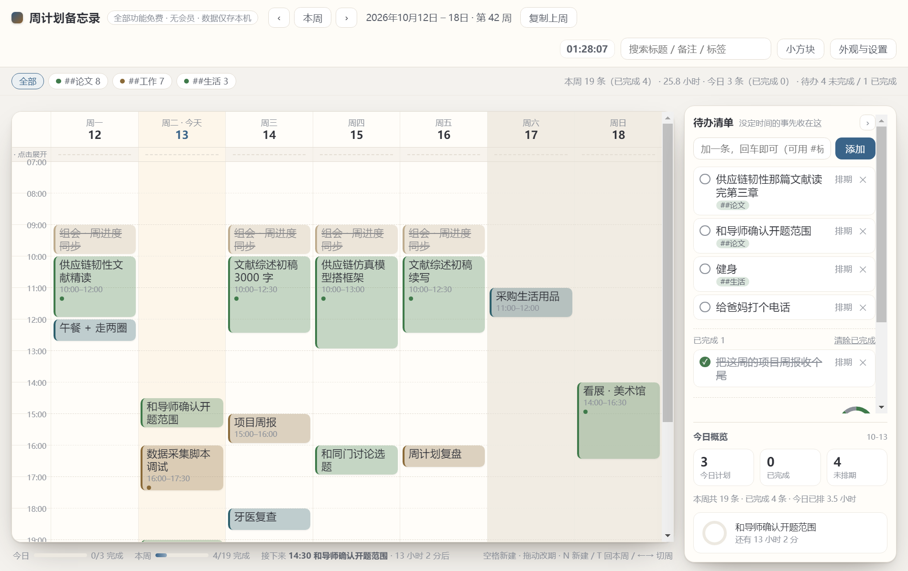
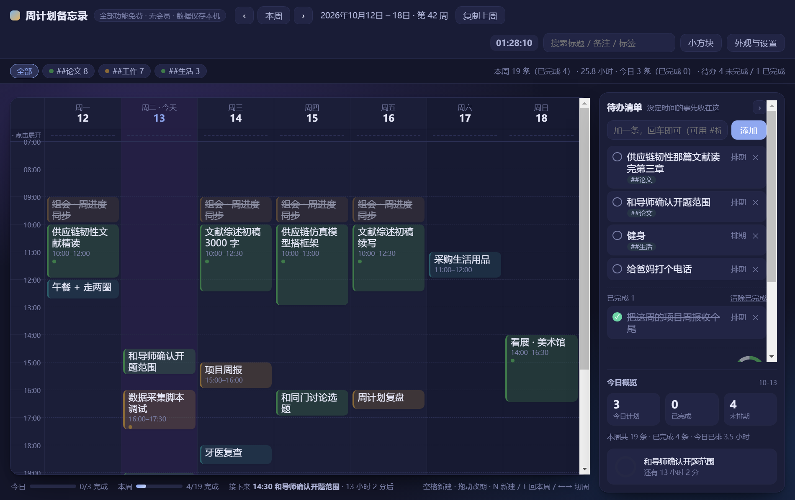
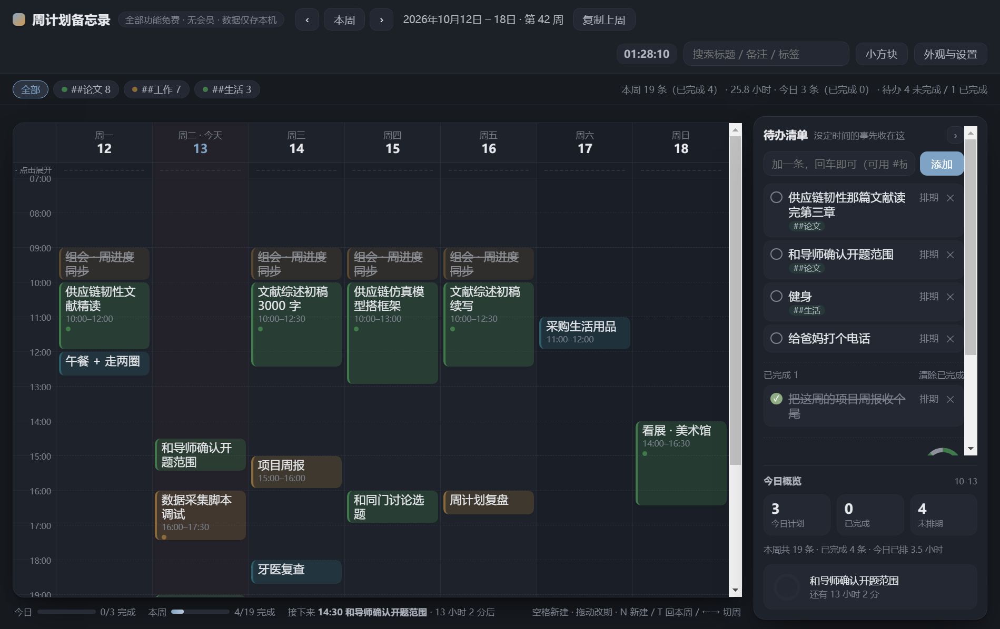
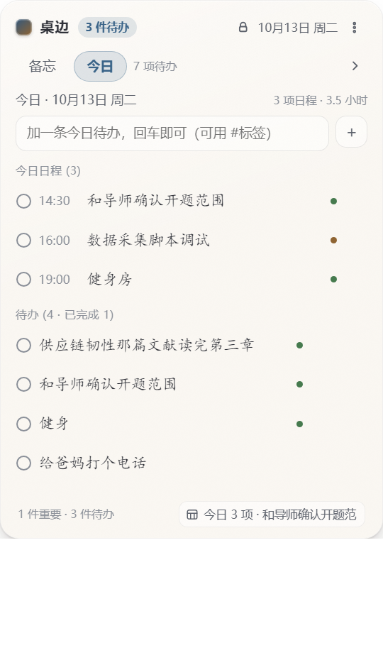
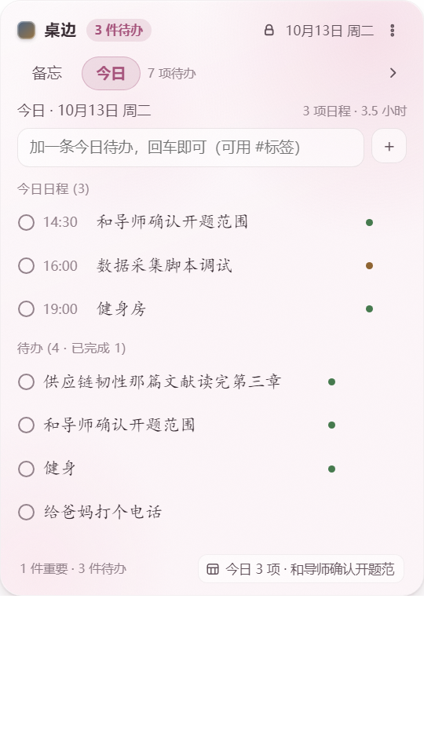
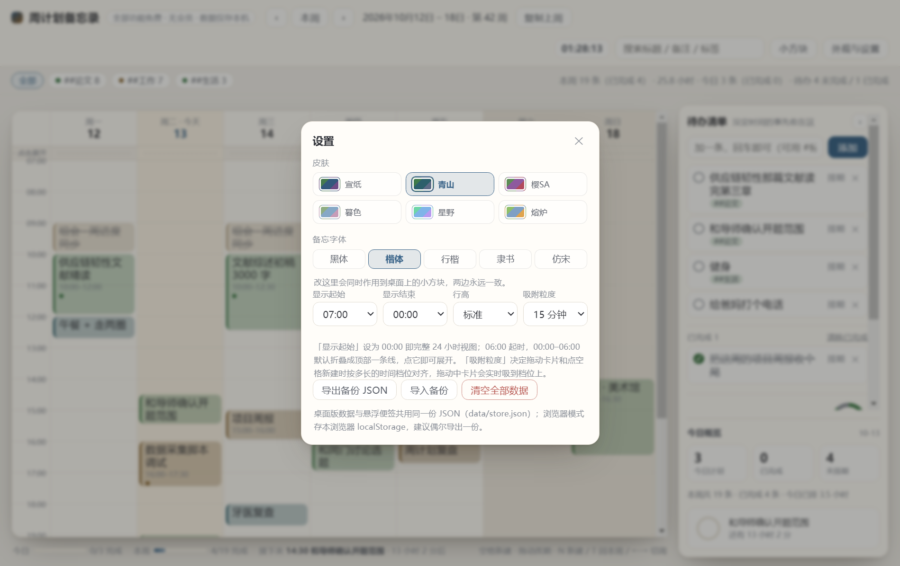

<div align="center">

# 桌边 · DeskPlan

**桌面周计划 + 贴边悬浮便签，一个应用两种形态**

[](https://www.electronjs.org/)
[](LICENSE)
[](package.json)

</div>

完整形态是周计划主窗口；最小化或失焦 3 秒自动收起成屏幕右缘的窄悬浮条，一份数据源（`data/store.json`）。



<p align="center">
  
  
</p>
<p align="center"><sub>宣纸 · 素雅耐看，默认</sub> &nbsp;&nbsp;&nbsp; <sub>星野 · 夜间深色</sub></p>

---

## 这是什么

一个自己每天真在用的桌面工具。左边是周计划时间网格（拖拽排期、点空白新建、卡片直接拖动改期），右边贴着屏幕边缘收着一条窄条，需要时鼠标移过去滑出来看今日待办和便签。

两个界面共享同一份 `data/store.json`，在任何一个窗口改，另一边立刻跟着变，不存在"同步"按钮。

技术栈：Electron 33.2.0 + 原生 HTML/CSS/JS，除打包用的 electron-builder 外零运行时依赖。

由原 `apps/deskmemo`（悬浮小方框）与 `apps/weekplan`（周计划网页）合并而来。

---

## 快速开始

```bash
git clone https://github.com/Fratratio/deskplan.git
cd deskplan
npm install
npm start
```

需要 Node.js 18 以上（打包用的是 Electron 33）。

### 打包成安装包

```bash
npm run dist          # Windows：NSIS 安装包 + 免安装版 → release/
```

装完桌面和开始菜单各有一个入口，任务栏显示应用图标和名称，关窗口不退出，走托盘常驻。

<details>
<summary>浏览器 / 手机模式（可选）</summary>

```bash
npm run web           # 起本地服务器，自动开浏览器，端口 8777
```

数据存在浏览器 localStorage，与桌面版各存一份。想互通就用桌面版设置里的「导出备份 JSON / 导入备份」。
</details>

---

## 界面一览

### 周计划主界面

拖拽排期是核心：卡片可以整块拖到别的时间段或别的日子，落下时按设定粒度吸附（默认 15 分钟）。点空白格新建，点卡片看详情和备注。

<p align="center">
  
  
</p>
<p align="center"><sub>樱SA</sub> &nbsp;&nbsp;&nbsp; <sub>暮色</sub></p>

### 贴边悬浮窗

鼠标贴到屏幕右缘滑出来，移开几秒自动缩回，只留一条细线加今日待办数量。

<p align="center">
  
  
  
</p>

### 设置弹层

皮肤和字体在日历主界面里直接改，点一下就生效，两边同时变。



---

## 功能

**两种形态**
- 周计划主窗口和贴边悬浮条互相独立，可以同时开着，不存在"打开一个另一个就没了"
- 悬浮窗三档伸缩：贴边细线 → 小视图 → 完整侧边栏

**皮肤**
- 六套：宣纸 / 青山 / 樱SA / 暮色 / 星野 / 熔炉
- 全部配色、纹理走 CSS 自定义属性定义在 `app/shared/skins.css`，切皮肤只换一个 `data-skin` 属性
- 每套都验过对比度，深色皮肤下的卡片文字不会糊

**字体**
- 五档：黑体 / 楷体 / 行楷 / 隶书 / 仿宋
- 正文默认楷体，两个窗口实时同步

**质感**
- 不透明度、毛玻璃模糊、纸张噪点三个参数独立可调，即时生效，重启保持

**桌面化**
- 任务栏有图标有名称，Alt+Tab 能分辨是哪个窗口
- 关窗口不退出，托盘常驻，关掉的是界面不是进程
- 窗口位置、悬浮形态、边缘方向全部记住

**数据**
- 单文件 JSON，两端共享，主进程统一读写
- 支持导入导出备份
- 浏览器模式走 localStorage，能和数据文件互通

---

## 快捷键

| 操作 | 快捷键 |
|---|---|
| 唤起 / 收起悬浮窗 | `Ctrl+Shift+W` |
| 打开周计划主窗口 | `Ctrl+Shift+P` |
| 全屏时自动隐身 | 默认开，看视频打游戏不挡画面 |

---

## 项目结构

```
deskplan/
├─ package.json              # 唯一运行时依赖 electron 33.2.0；main 入口 app/main.js
├─ serve.js                  # 浏览器/手机模式的静态服务器（端口 8777）
├─ 启动桌边.bat              # 桌面版入口（双击）
├─ 自检.bat                  # 集成自检：验证两窗口共用一份数据
│
├─ app/                      # ---- 应用代码 ----
│  ├─ main.js                # 主进程：双窗口管理、共享存储、托盘、快捷键、跨窗口同步
│  ├─ preload-widget.js      # 悬浮窗 preload
│  ├─ preload-plan.js        # 周计划页 preload
│  ├─ shared/
│  │  ├─ store-schema.js     # 统一数据层：schema、迁移、两端各自的视图切片
│  │  ├─ bridge.js           # 把周计划页的 localStorage 读写接到主进程
│  │  ├─ theme-tokens.css    # 字体/字号/圆角/动效（不随皮肤变）
│  │  └─ skins.css           # 六套配色与 CSS 纹理，按 data-skin 切换
│  ├─ widget/                # 贴边悬浮窗前端
│  │  ├─ index.html
│  │  ├─ styles.css
│  │  ├─ renderer.js
│  │  └─ motion.js           # 动效引擎（FLIP / View Transitions）
│  └─ plan/                  # 周计划主页面
│     ├─ index.html
│     ├─ styles.css
│     └─ app.js
│
├─ assets/                   # app.ico / app.png / tray.png
├─ data/                     # store.json（运行时生成，不进版本库）
├─ docs/                     # 优化落地过程记录、快捷方式排查指南、界面预览
└─ tools/                    # 自检脚本、截图工具、图标生成、快捷方式读写
```

---

## 开发过程中踩的坑

这一栏记的都是实际卡住过的点，不是通用建议。

**页面 `<title>` 会覆盖窗口标题，进而决定任务栏上显示什么。** 两个窗口的 `<title>` 必须都写应用名，写成「周计划备忘录」这类内部叫法，任务栏图标旁边就会跟着显示它。

**`ELECTRON_RUN_AS_NODE` 污染进程环境。** 某些终端和脚本工具会把这个变量塞进环境，一存在 `require('electron')` 返回的就是一串路径而不是模块对象，`app` 全是 undefined，进程第一行就崩。外部表现是"双击图标毫无反应"。`main.js` 开头做了自愈：检测到就清掉变量重启自身。

**透明无边框窗口要早建。** 后创建的 `BrowserWindow` 走透明合成路径时可能直接 `ERR_FAILED` 连主文档都加载不出来。截图脚本里把悬浮窗排在日历窗口之前拍才稳定。

**`capturePage()` 在隐藏或半透明窗口里会拿到上一帧。** 截图前必须先注入 `transition:none` 并等两次 `requestAnimationFrame`。六套皮肤连拍时错位一格，栽的就是这里。

**悬浮窗的皮肤属性挂在 `<body>` 上，日历挂在 `<html>` 上。** `skins.css` 里 `:root`、`html[data-skin]`、`body[data-skin]` 三个作用域都写了，改的时候只设一个就有一边不生效。

**硬编码绝对路径是白费力气。** 早期版本把数据目录写死成 `D:\WorkBuddyData\apps\deskplan\data`，换台机器 clone 下来就是死路。现在改成候选链：环境变量 → 项目根 `data/` → 系统 `userData/data`，装到不可写位置时自动落到用户目录。

**npm 全局代理指向一个没在跑的进程。** 所有请求 ECONNREFUSED。项目级 `.npmrc` 覆盖掉它之后直连镜像源就通了（这个文件是本机环境的产物，没有进版本库）。

---

## 自检脚本

改完代码跑一遍，比手动点靠谱。

```bash
npm run selftest        # 端到端：两窗口共享数据、拖拽换算、增删改统计
```

`tools/` 下还有一批专项脚本，都是「跑真实代码路径、不打桩」：

| 脚本 | 验什么 |
|---|---|
| `e2e.js` | 日历功能回归：列数、吸附、拖拽落点、增删改 |
| `fontsync.js` | 日历与悬浮窗字体双向同步 |
| `skins.js` | 六套皮肤对比度、纹理、切换即时性 |
| `pkgself.js` | 打包产物自检，验的是"装完能不能用" |
| `datadir-check.js` | 数据目录候选链：可写就用项目目录，不可写就落到 userData |
| `docshot.js` | 给 README 生成展示图（就是这个仓库里的截图） |

---

## 延伸文档

| 文档 | 内容 |
|---|---|
| [docs/技术文档.md](docs/技术文档.md) | 实现细节、迭代过程记录、数据共享怎么做的 |
| [docs/快捷方式故障排查与重建指南.md](docs/快捷方式故障排查与重建指南.md) | Windows 快捷方式各种坑的排查手册 |
| [docs/优化落地说明-2026-10-11.md](docs/优化落地说明-2026-10-11.md) | 第一轮产品优化的逐项落地记录 |
| [docs/悬浮窗质感预览.html](docs/悬浮窗质感预览.html) | 不透明度 / 毛玻璃 / 噪点三参数的实时预览 |
| [docs/字体与配色样张.html](docs/字体与配色样张.html) | 五档字体 × 六套皮肤的样张对照 |

---

## 许可

MIT，见 [LICENSE](LICENSE)。